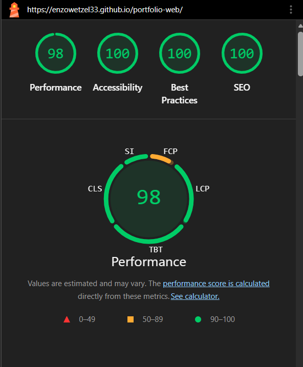

# Portfolio web de Enzo Sebastián Wetzel

Trabajo Final de **Diseño UX-UI 2026** · Licenciatura en Sistemas de Información · UADER, FCyT, sede Concepción del Uruguay.

Portfolio personal de una sola página, con navegación por anclas, pensado para mostrar proyectos, skills y formación.

- **Sitio publicado:** https://enzowetzel33.github.io/portfolio-web/
- **Repositorio:** https://github.com/EnzoWetzel33/portfolio-web
- **Diseño en Figma:** https://www.figma.com/design/1jwW3GLbYGsnfatwLx330I/TP-Final-UX-UI-Portfolio

## Stack

- HTML5 semántico
- CSS3 puro, con variables en `:root`, Flexbox y Grid (sin Tailwind ni frameworks)
- JavaScript vanilla (menú mobile y modal del caso de estudio)
- Tipografías de Google Fonts con `font-display: swap`: Manrope (títulos) e Inter (texto)

## Estructura

```
portfolio-web/
├── index.html
├── styles.css
├── script.js
├── img/            imágenes en WebP y og.png
├── capturas/       reporte de Lighthouse
└── README.md
```

## Despliegue

Publicado con **GitHub Pages**, desde la rama `main` (carpeta raíz). Cada `push` a `main` actualiza el sitio automáticamente.

1. En el repositorio: Settings → Pages.
2. Source: "Deploy from a branch", rama `main`, carpeta `/ (root)`.
3. Guardar y esperar el enlace público con HTTPS.

## Decisiones de diseño

- **Concepto:** Orden, curiosidad y cercanía.
- **Orden:** grilla clara, espacios amplios y jerarquía marcada.
- **Curiosidad:** acento ámbar y detalles al pasar el mouse.
- **Cercanía:** textos en primera persona y tipografía amable.
- **Paleta:** azul noche, azul primario, ámbar de acento y neutros claros.
- **Accesibilidad:** link "Saltar al contenido", foco visible, menú mobile con `aria-expanded` y `aria-controls`, contraste revisado y `prefers-reduced-motion`.

## Capturas

### Lighthouse (mobile)



## Créditos

- Fuentes: Manrope e Inter (Google Fonts).
- Imágenes optimizadas con Squoosh.
- Sin templates de terceros: el diseño y el código son propios.

## Uso de IA

Código y textos generados con asistencia de IA (Claude); revisados y ajustados por el autor.
